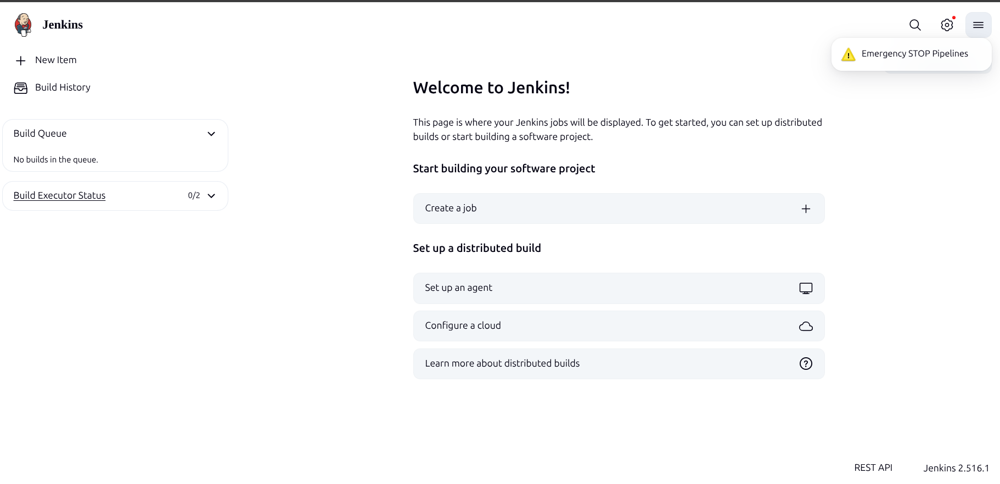
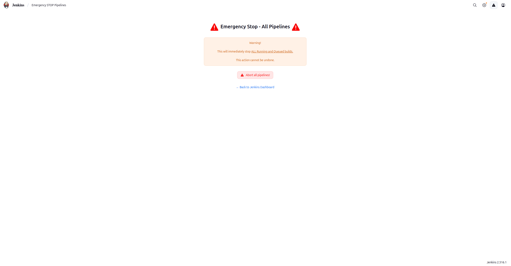
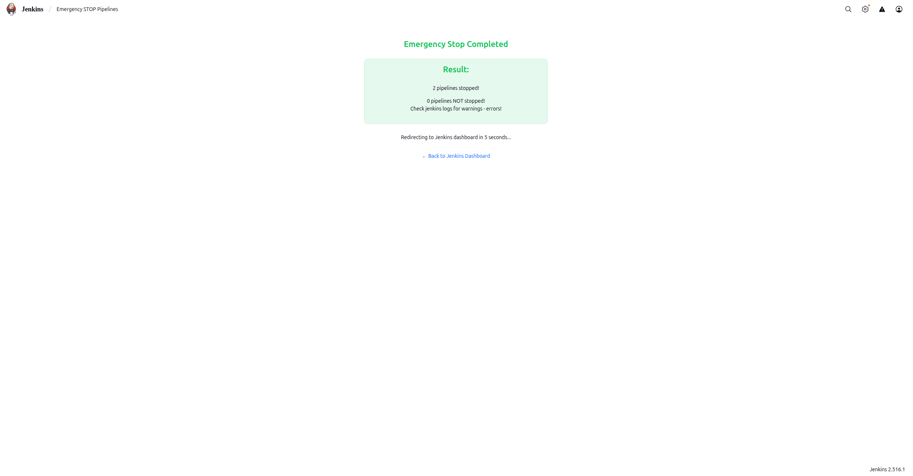

# Emergency Stop Pipelines Plugin

A Jenkins plugin that provides an emergency stop button to immediately halt all running and queued Jenkins builds.

## Features

- **Global Emergency Stop** — Stop all running builds and queued items across the entire Jenkins instance from the top navigation bar.
- **Folder-Level Emergency Stop** — Stop all running builds and queued items within a specific folder and all of its subfolders recursively.
- **Job-Level Emergency Stop** — Stop all running builds and queued items for a single job from its sidebar.
- **Permission-Gated** — All actions are restricted to users with `ADMINISTER` permission. Non-admin users never see the action links.
- **CSRF Protection** — All destructive actions use POST requests with Jenkins CSRF crumb handling.
- **Audit Trail** — Build interruptions include `CauseOfInterruption.UserInterruption` with the triggering user's name.
- **Result Counting** — The global stop page reports how many pipelines were stopped vs. not stopped.
- **Auto-Redirect** — The success page auto-redirects to the Jenkins dashboard after 5 seconds.

## Installation

Install the plugin from the Jenkins Plugin Manager or download the latest HPI from the [releases page](https://github.com/jenkinsci/emergency-stop-pipelines-plugin/releases).

## Usage

### Global Stop

After installing the plugin, an **Emergency STOP Pipelines** button (yellow warning icon) appears in the top navigation bar for users with `ADMINISTER` permission. Clicking it navigates to a confirmation page. After confirming, all running builds across the entire Jenkins instance are interrupted and all queued items are cancelled.

The success page shows the number of pipelines stopped and not stopped, and auto-redirects to the dashboard after 5 seconds.





### Folder Stop

A **Emerg. Stop Folder Pipelines** button appears in the sidebar for folders where the user has `ADMINISTER` permission. It stops all running builds and queued items within that folder and all nested subfolders.

### Job Stop

An **Emerg. Stop All Builds** button appears in the sidebar for individual jobs where the user has `ADMINISTER` permission. It stops all running builds and queued items for that specific job.

## Endpoints

| Scope | URL | Method | Description |
|-------|-----|--------|-------------|
| Global | `/emergency-stop-pipelines` | GET | Confirmation page (requires admin) |
| Global | `/emergency-stop-pipelines/stop` | POST | Stop all running builds and queues |
| Job | `/<job-path>/emergency-stop-job` | GET | Sidebar task link (requires admin) |
| Job | `/<job-path>/emergency-stop-job/stop` | POST | Stop all builds for this job |
| Folder | `/<folder-path>/emergency-stop-folder-pipelines` | GET | Sidebar task link (requires admin) |
| Folder | `/<folder-path>/emergency-stop-folder-pipelines/stop` | POST | Stop all builds in folder tree |

## Behavior Details

- Builds are interrupted with `Result.ABORTED` and a `CauseOfInterruption.UserInterruption("EMERGENCY STOP by <username>")` is recorded in the build log.
- Queue items are cancelled at all three scopes (global, folder, job).
- The folder-level action recursively traverses all subfolders to find and stop builds.
- The global action iterates over `Jenkins.getAllItems(Job.class)` to cover the entire instance.
- If a running build does not have an active executor, it is counted as "not stopped" and a warning is logged.

## Requirements

- Jenkins 2.568 or later
- Java 21 or later
- [cloudbees-folder](https://plugins.jenkins.io/cloudbees-folder/) plugin (for folder-level stop support)

## Configuration

No additional configuration is required. The plugin works out of the box after installation.

## Building from Source

```bash
git clone https://github.com/jenkinsci/emergency-stop-pipelines-plugin.git
cd emergency-stop-pipelines-plugin
mvn clean verify
```

## Code Quality

This project uses [Spotless](https://github.com/diffplug/spotless) for code formatting. Run the following to format or check your code:

```bash
mvn spotless:apply
mvn spotless:check
```

## License

Licensed under the MIT License. See [LICENSE](LICENSE) for details.
